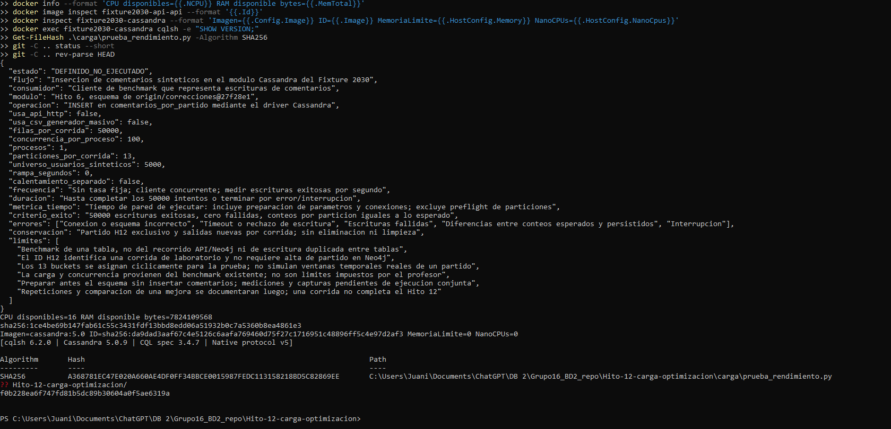
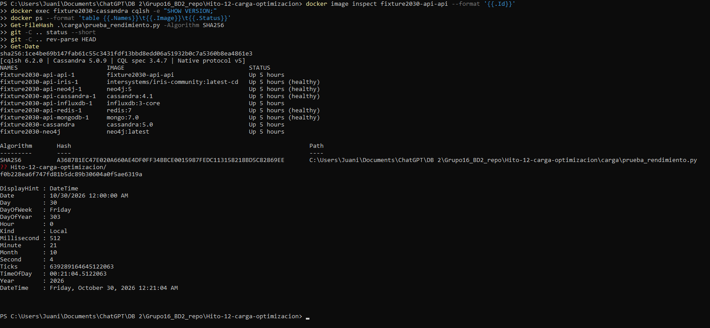
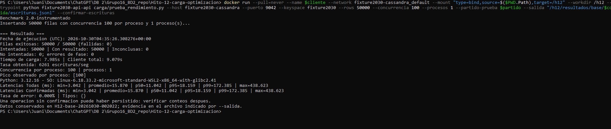
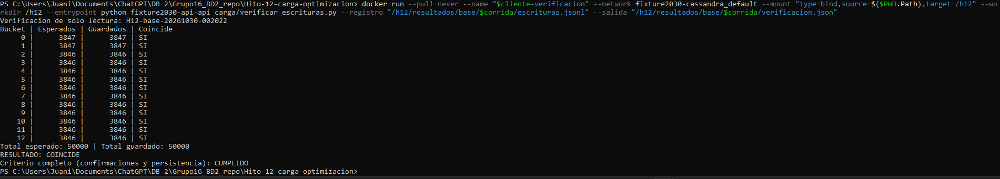
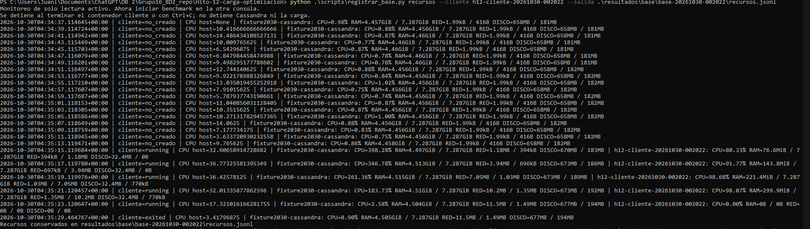
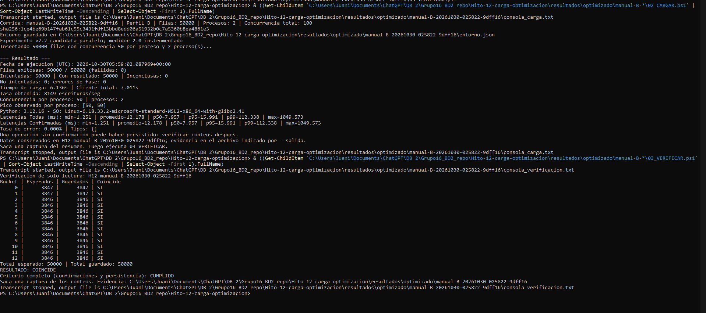
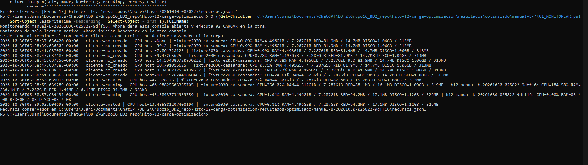

# Evidencia Hito 12 — transcripción del documento

Fuente: [DOCX completo](Evidencia%20Hito%2012.docx). Exportación del texto, tablas y capturas; las aclaraciones editoriales están en los documentos temáticos.

Evidencia Hito 12


Flujo seleccionado

Elegimos el flujo de publicar y consultar comentarios de los partidos del fixture 2030 dado que el comportamiento de los comentarios implica gran cantidad de operaciones simultaneas y picos concentrados en determinados partidos, lo cual nos permite estudiar qué ocurre en el recorrido completo (aplicación → API → bases) para poder encontrar un cuello de botella y encontrar una posible solución

Para lo anterior, vamos a utilizar los endpoints de comentarios definidos en hitos anteriores

¿Quién genera la operación?

Un hincha desde la aplicación. Durante las pruebas, un generador de carga simulará esas consultas y publicaciones.

¿Qué datos recibe?

Para publicar, recibe el identificador del partido, país del hincha, identificador y nombre del usuario, contenido del comentario y una clave para identificar los reintentos. Para consultar, recibe partido, país, ventana de tiempo y parámetros de paginación.

¿Qué fuentes utiliza?

Al publicar, primero consulta Neo4j para comprobar que el partido exista y después guarda el comentario en Cassandra. La consulta de comentarios se resuelve en Cassandra, por partido, país y ventana de 30 minutos.

¿Qué tipo de operación es?

Se realizan operación de lectura (recuperar paginas de comentarios recientes en tiempo real) y escritura (Publicar comentarios)

¿Qué respuesta esperamos?

Esperamos una respuesta 201 si es nuevo, 200 si es un reintento reconocido. Al consultar, esperamos HTTP 200 con los comentarios mas recientes y un cursos para continuar

¿Qué volumen y frecuencia proyectamos?

Se plantean más de un millón de comentarios por partido, con especial intensidad en goles/jugadas importantes. Alrededor de 185 comentarios por segundo

¿Cuándo consideramos que fue exitosa?

Cuando el comentario aceptado fue guardado y puede recuperarse en su particion correspondiente

¿Qué errores registramos?

Datos inválidos (422), partido inexistente al publicar (404), conflictos con la clave de reintento (409), dependencia no disponible (503), timeout (504) y errores inesperados (500). También registraremos demoras, operaciones fallidas y posibles inconsistencias, usando el request_id para seguir cada pedido.


Escenario de carga

Vamos a probar la escritura de comentarios del Fixture 2030 en el módulo Cassandra. Un proceso de prueba generará 50.000 comentarios sintéticos y los enviará con hasta 100 escrituras simultáneas, utilizando un proceso. La prueba finalizará cuando se hayan intentado todas las inserciones. Registraremos escrituras exitosas, fallidas, duración y comentarios escritos por segundo, y después verificaremos los datos guardados.

El entorno y linea base es el siguiente es el siguiente:


| Aspecto | Definición reproducible |

| --- | --- |

| Qué probamos | Inserción de comentarios sintéticos del Fixture 2030 en el módulo Cassandra del Hito 6. |

| Consumidor | Un proceso de benchmark que representa publicaciones de comentarios. |

| Recorrido | Cliente Python → driver Cassandra → tabla comentarios_por_partido. La API y Neo4j no intervienen. |

| Volumen | 50.000 comentarios, generados por el propio benchmark. |

| Datos | 5.000 usuarios ficticios, diez comentarios por usuario, contenido fijo y valores generados de manera determinista con semilla 2030. |

| Distribución | 13 particiones: dos reciben 3.847 registros y once reciben 3.846. Cada corrida utiliza un identificador H12 exclusivo. |

| Concurrencia | Hasta 100 operaciones en curso, con un proceso. Se registra también el pico observado. |

| Rampa y sostenimiento | Sin rampa. El cliente repone operaciones mientras quedan pendientes; la concurrencia disminuye al terminar el lote. |

| Duración | Hasta completar los intentos, sufrir un fallo fatal o recibir una interrupción. Los errores individuales se registran sin detenerse en el primero. |

| Latencia por operación | Desde que el cliente inicia el envío hasta recibir confirmación o error. Incluye driver, red y posibles reintentos; no es tiempo puro del servidor. |

| Estadísticos | Mínima, promedio, p50, p95, p99 y máxima. Se separan operaciones confirmadas y errores, y se conservan las muestras individuales. |

| Throughput | Escrituras confirmadas por segundo durante la carga. El tiempo total del cliente se informa por separado. |

| Errores | Cantidad, porcentaje y clase de excepción. Se distinguen errores, operaciones inconclusas y operaciones no intentadas. |

| Recursos y estabilidad | CPU/RAM del host y contenedores, red y BlockIO mediante muestreo; resultados por segundo para observar pausas, variaciones y errores. |

| Criterio de éxito | 50.000 confirmaciones, cero errores o inconclusas y conteos persistidos iguales a los esperados en las 13 particiones. |

| Reproducción | Misma versión instrumentada, hashes, parámetros, reglas de generación y condiciones del entorno; nueva carpeta e ID por corrida, conservando los anteriores. |

| Limitaciones | Una tabla y datos controlados. No reproduce todo el tráfico del TPO, la popularidad entre partidos ni el recorrido HTTP completo. |






Vamos a cargar datos para la prueba con la siguiente configuración


| Elemento  | Definición  |

| --- | --- |

| Volumen de datos | 50.000 comentarios sintéticos |

| Cantidad o tasa de operaciones | 50.000 inserciones; la tasa obtenida se medirá |

| Concurrencia | Hasta 100 escrituras en curso, con un proceso |

| Duración | Variable: hasta completar los 50.000 intentos; se registra el tiempo real |

| Ramp-up | Sin rampa: se utiliza directamente la concurrencia configurada |

| Sostenimiento | Se mantiene el límite de 100 operaciones en curso mientras quedan escrituras por enviar; disminuye al terminar el lote |

| Finalización | Se completan los intentos o la ejecución termina por error o interrupción |


El script se encuentra dentro de los archivos del hito 12.


Seleccionamos un conjunto sintético y controlado para obtener una primera medición reproducible del módulo de comentarios. Su tamaño permite ejecutar y verificar la prueba, pero los resultados se limitan a este volumen y distribución; no permiten afirmar que el sistema soporte automáticamente la carga total proyectada del Fixture 2030.Los datos a cargar tienen las siguientes características:


| Punto  | definición |

| --- | --- |

| Origen | Datos ficticios generados por el benchmark del Hito 6, adaptado para el Hito 12. No contienen información de usuarios reales. |

| Método de generación | El script construye identificadores, usuarios, contenido, fechas, estado de moderación y likes mediante reglas deterministas y semilla fija. |

| Distribución | 50.000 comentarios repartidos entre 13 particiones: dos reciben 3.847 registros y las otras once, 3.846. Se utilizan 5.000 identificadores de usuario, con diez comentarios por usuario. |

| Representatividad | Permite estudiar escrituras simultáneas sobre el modelo de comentarios y comprobar su persistencia. |

| Limitaciones | El contenido es repetitivo, los usuarios tienen una distribución uniforme y los buckets se asignan cíclicamente. No reproduce fielmente ráfagas por goles, horarios reales, partidos con distinta popularidad ni todo el volumen proyectado del TPO. |


Ejecución inicial

Ejecutamos y obtuvimos el siguiente resultado





En cuanto al hardware, monitoreando obtuvimos los siguientes resultados :




| Recurso | Máximo observado |

| --- | --- |

| CPU del host | 36,77 % |

| CPU de Cassandra | 398,28 % |

| RAM de Cassandra | 4,515 GiB |

| CPU del cliente | 98,68 % |

| RAM del cliente | 299,9 MiB |


Hipótesis optimización

Se implementaron dos variantes de optimización sobre el flujo de inserción de comentarios en Cassandra. Ambas se vinculan con la posible limitación del cliente identificada en la línea base: consumo cercano a un núcleo y presencia de latencias elevadas en una parte de las operaciones.

| Mejora implementada | Descripción y justificación | Hipótesis de mejora |

| --- | --- | --- |

| Reducción de concurrencia — v2.1 | Se redujo de 100 a 50 la cantidad máxima de operaciones simultáneas, manteniendo un proceso y 50.000 escrituras. Busca disminuir la presión generada por las solicitudes en curso. | Una menor concurrencia podría reducir las latencias altas, especialmente el p99, sin perder una proporción importante de throughput. |

| Paralelismo controlado — v2.2 | Se distribuyeron las escrituras entre dos procesos con sesiones independientes y 50 operaciones concurrentes cada uno. Se conserva un máximo global de 100, igual al control de un proceso con concurrencia 100. | Repartir el envío y procesamiento de respuestas entre dos procesos podría aprovechar más núcleos y mejorar el throughput o las latencias si el cliente constituye una limitación. |

Para evaluar la segunda mejora, también se corrigió la generación de datos para que ambos perfiles produzcan los mismos valores por índice global y se incorporó una barrera de inicio, ubicada después de preparar las conexiones, las sentencias y los datos. Estos controles permiten comparar condiciones equivalentes. Se mantuvieron la consulta preparada, las 13 particiones, el esquema y el instrumento de medición.

a fin de resolver lo anterior, se implementaron las siguientes modificaciones

1) se agregó la selección de parámetros según el perfil:


```python
if args.concurrencia is None:
    args.concurrencia = 100 if args.perfil == "A" else 50

if args.procesos is None:
    args.procesos = 1 if args.perfil == "A" else 2

```

Así, --perfil B ejecuta dos trabajadores, cada uno encargado de 25.000 filas y con hasta 50 operaciones en curso. El máximo global continúa siendo 100.

2) Creación explícita de procesos y coordinación

En la función ejecutar(), del mismo archivo, cambiamos la creación del pool.

```python
contexto = multiprocessing.get_context('spawn')
barrera = contexto.Barrier(procesos)

with contexto.Pool(
    procesos,
    initializer=inicializar_worker,
    initargs=(barrera,)
) as pool:
    salidas = pool.map(trabajo, tareas)

```

spawn inicia trabajadores independientes. Cada trabajador conserva la creación de su propia conexión, sesión y sentencia preparada dentro de trabajo(). La barrera coordina el inicio de ambos trabajadores. No se supone que spawn sea más rápido: se utiliza para controlar cómo se crean los procesos.

3) Esperar a que ambos trabajadores estén preparados

En trabajo() incorporamos esta espera inmediatamente antes de comenzar a medir y enviar:

```python
medida = SesionMedida(session, indice, desde)
esperar_inicio()
inicio = time.perf_counter_ns()

resultados = execute_concurrent_with_args(
    medida, insert, params,
    concurrency=concurrencia,
    raise_on_first_error=False
)

```

Esto evita que un proceso empiece a enviar mientras el otro todavía prepara sus datos. También agregué abortar_inicio() para liberar la espera si falla la preparación de un trabajador.

Resultados hipótesis

Corrimos y obtuvimos lo siguiente:





Lo anterior al comparar con la línea base histórica:

| Métrica | Base: 1 proceso × 100 | Modificada: 2 procesos × 50 | Variación |

| --- | --- | --- | --- |

| Tiempo de carga | 7,985 s | 6,136 s | −23,2% |

| Throughput | 6.261 escrituras/s | 8.149 escrituras/s | +30,1% |

| Latencia promedio | 15,870 ms | 12,178 ms | −23,3% |

| p50 | 11,042 ms | 7,957 ms | −27,9% |

| p95 | 18,159 ms | 15,991 ms | −11,9% |

| p99 | 172,385 ms | 112,338 ms | −34,8% |

| Latencia máxima | 438,623 ms | 1.049,573 ms | +139,3%: regresión |

| Escrituras fallidas | 0 | 0 | Sin cambios |

| Registros persistidos | 50.000 | 50.000 | Integridad conservada |

La variante paralela mostró un incremento del throughput del 30,1% y una reducción del p99 del 34,8% respecto de la línea base histórica, manteniendo 50.000 escrituras confirmadas y persistidas sin errores. Sin embargo, la latencia máxima aumentó de 438,623 a 1.049,573 ms, por lo que también se identificó una regresión en el peor caso observado.

El monitor registró una muestra activa del cliente con 184,58% de CPU y 230,1 MiB de memoria, compatible con el uso de más de un núcleo. La cobertura de recursos fue limitada por la corta duración de la prueba y no permite establecer consumo sostenido.

Los resultados son favorables como comparación exploratoria. Para atribuir la mejora al paralelismo y evaluar su repetibilidad, queda pendiente ejecutar el control A con el mismo código v2.2 y repetir ambas condiciones.

Puesto de forma breve, obtuvimos:

30,1% más escrituras por segundo.

23,2% menos tiempo para cargar los 50.000 comentarios.

34,8% menos latencia p99.

Cero errores y todos los registros guardados.

Comparación con relacional

Se compara el flujo de inserción de comentarios del Fixture 2030 en Cassandra con una alternativa relacional en PostgreSQL. La comparación considera el acceso a los datos, las operaciones, las garantías y las condiciones de conveniencia de cada modelo.


| Aspecto solicitado | Cassandra: implementación analizada | PostgreSQL: alternativa relacional |

| --- | --- | --- |

| Estructura de datos | Tabla comentarios_por_partido, particionada por partido y bucket, con comentarios ordenados por comentario_id. | Tabla comentarios, con clave primaria e índice compuesto por partido, bucket y fecha; posibles claves foráneas a partidos y usuarios. |

| Patrón de acceso | Inserciones frecuentes y consultas dirigidas a un partido y bucket determinados. | Inserciones y consultas por partido; posibilidad de relacionar comentarios con usuarios y partidos mediante JOIN. |

| Operaciones involucradas | 50.000 INSERT individuales mediante sentencia preparada y ejecución concurrente. SELECT COUNT por partición para verificar persistencia. | INSERT parametrizados y concurrentes, SELECT COUNT para verificar registros y SELECT con filtros e índices para recuperar comentarios. |

| Garantías esperadas | Confirmaciones según la consistencia configurada. La prueba contrastó confirmaciones con registros persistidos; las relaciones entre entidades se validan desde la aplicación. | Transacciones ACID, unicidad, claves foráneas y restricciones para mantener integridad; posibilidad de operaciones atómicas entre varias tablas. |

| Condiciones de conveniencia | Cuando predominan escrituras distribuidas y consultas conocidas por clave de partición, sin necesidad de JOIN. | Cuando se necesitan relaciones, consultas variadas y transacciones que involucren comentarios, usuarios y partidos. |


Data mart

Elegimos armar un Data Mart de actividad de comentarios para responder una pregunta concreta: ¿qué partidos y minutos concentran más comentarios y usuarios activos? Esto nos serviría para reconocer momentos de mayor participación y decidir dónde prestar más atención a la capacidad del sistema y a la moderación.


La fuente es la tabla comentarios_por_partido de Cassandra. Tomamos el código del partido, el identificador del comentario, el usuario, la fecha, el estado de moderación y los likes. Integramos los registros de los distintos buckets y generamos una fila por partido y minuto, con cantidad de comentarios, usuarios distintos, comentarios visibles, comentarios en otros estados y suma de likes observados. “Otros estados” no significa necesariamente pendientes de moderación.


Para que los datos sean comparables, llevamos las fechas a UTC y las agrupamos por minuto. Usamos el código del partido para identificarlo y el identificador del comentario para controlar duplicados. Los usuarios se cuentan una sola vez dentro de cada partido y minuto; no corresponde sumar esos usuarios entre minutos como si fueran personas diferentes. Los likes representan el valor observado al extraer, no necesariamente likes recibidos durante ese minuto.


Proponemos actualizar el resumen cada cinco minutos, separado del proceso que publica comentarios, y aceptar un retraso de hasta diez minutos, mostrando cuándo se hizo la última actualización. Son decisiones del equipo, todavía no medidas ni automatizadas. Para contemplar datos tardíos o cambios de moderación, revisaríamos los últimos treinta minutos; las correcciones más antiguas requerirían un reprocesamiento específico.


Antes de publicar una actualización, comprobaríamos los conteos por bucket y el total de comentarios contra la suma del resumen. Si aparecen duplicados, datos obligatorios faltantes o una falla parcial, conservaríamos la última versión válida y registraríamos el problema. Cada actualización sería una nueva versión completa: repetirla no debe sumar otra vez los mismos comentarios.


La ventaja es que un reporte podría consultar un resumen pequeño mediante SQL, en lugar de recorrer y agrupar repetidamente los comentarios de Cassandra. El costo es mantener una copia agregada, ejecutar la extracción y aceptar cierta demora respecto de la fuente. Además, leer varias particiones mientras están cambiando no garantiza una fotografía atómica; por eso nuestra demostración utiliza una corrida terminada.


Para el laboratorio preparamos una proyección local en SQLite. Los identificadores H12 representan pruebas, no partidos reales. Como nuestros datos sintéticos abarcan un único minuto, la demostración permite comprobar la extracción, los agregados y su procedencia, pero no demostrar picos reales entre minutos ni comparar popularidad entre partidos. La propuesta cubre el diseño solicitado.

Ejecutamos una extracción de los comentarios de la corrida terminada en Cassandra y generamos una proyección local en SQLite. Se integraron las 13 particiones y se comprobó que sus conteos coincidieran con los esperados.


La consulta SQL devolvió una fila correspondiente al partido de prueba y al minuto 2030-06-08T18:00:00+00:00: 50.000 comentarios, 5.000 usuarios distintos, 50.000 comentarios visibles, cero en otros estados y 249.661 likes acumulados. Una segunda consulta confirmó que la suma de comentarios de la proyección coincide con los 50.000 registros extraídos.


Esto valida la extracción y los conteos del resumen para este conjunto de datos. No demuestra diferencias de actividad entre partidos o minutos, porque la prueba contiene un único partido sintético y un solo minuto. La actualización periódica, el tratamiento de datos tardíos y la recuperación ante fallas parciales quedan como políticas propuestas, todavía no probadas de extremo a extremo.


Ejecutamos


