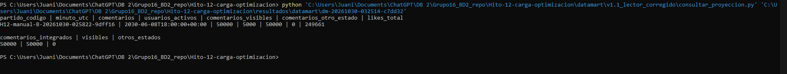

# Integración del Data Mart

Texto organizado a partir de [Evidencia Hito 12.docx](evidencia/Evidencia%20Hito%2012.docx), conservado completo. Las aclaraciones de alcance separan propuestas y mediciones.

Elegimos armar un Data Mart de actividad de comentarios para responder una pregunta concreta: ¿qué partidos y minutos concentran más comentarios y usuarios activos? Esto nos serviría para reconocer momentos de mayor participación y decidir dónde prestar más atención a la capacidad del sistema y a la moderación.

La fuente es la tabla comentarios_por_partido de Cassandra. Tomamos el código del partido, el identificador del comentario, el usuario, la fecha, el estado de moderación y los likes. Integramos los registros de los distintos buckets y generamos una fila por partido y minuto, con cantidad de comentarios, usuarios distintos, comentarios visibles, comentarios en otros estados y suma de likes observados. “Otros estados” no significa necesariamente pendientes de moderación.

Para que los datos sean comparables, llevamos las fechas a UTC y las agrupamos por minuto. Usamos el código del partido para identificarlo y el identificador del comentario para controlar duplicados. Los usuarios se cuentan una sola vez dentro de cada partido y minuto; no corresponde sumar esos usuarios entre minutos como si fueran personas diferentes. Los likes representan el valor observado al extraer, no necesariamente likes recibidos durante ese minuto.

Proponemos actualizar el resumen cada cinco minutos, separado del proceso que publica comentarios, y aceptar un retraso de hasta diez minutos, mostrando cuándo se hizo la última actualización. Son decisiones del equipo, todavía no medidas ni automatizadas. Para contemplar datos tardíos o cambios de moderación, revisaríamos los últimos treinta minutos; las correcciones más antiguas requerirían un reprocesamiento específico.

Antes de publicar una actualización, comprobaríamos los conteos por bucket y el total de comentarios contra la suma del resumen. Si aparecen duplicados, datos obligatorios faltantes o una falla parcial, conservaríamos la última versión válida y registraríamos el problema. Cada actualización sería una nueva versión completa: repetirla no debe sumar otra vez los mismos comentarios.

La ventaja es que un reporte podría consultar un resumen pequeño mediante SQL, en lugar de recorrer y agrupar repetidamente los comentarios de Cassandra. El costo es mantener una copia agregada, ejecutar la extracción y aceptar cierta demora respecto de la fuente. Además, leer varias particiones mientras están cambiando no garantiza una fotografía atómica; por eso nuestra demostración utiliza una corrida terminada.

Para el laboratorio preparamos una proyección local en SQLite. Los identificadores H12 representan pruebas, no partidos reales. Como nuestros datos sintéticos abarcan un único minuto, la demostración permite comprobar la extracción, los agregados y su procedencia, pero no demostrar picos reales entre minutos ni comparar popularidad entre partidos. La propuesta cubre el diseño solicitado.

Ejecutamos una extracción de los comentarios de la corrida terminada en Cassandra y generamos una proyección local en SQLite. Se integraron las 13 particiones y se comprobó que sus conteos coincidieran con los esperados.

La consulta SQL devolvió una fila correspondiente al partido de prueba y al minuto 2030-06-08T18:00:00+00:00: 50.000 comentarios, 5.000 usuarios distintos, 50.000 comentarios visibles, cero en otros estados y 249.661 likes acumulados. Una segunda consulta confirmó que la suma de comentarios de la proyección coincide con los 50.000 registros extraídos.

Esto valida la extracción y los conteos del resumen para este conjunto de datos. No demuestra diferencias de actividad entre partidos o minutos, porque la prueba contiene un único partido sintético y un solo minuto. La actualización periódica, el tratamiento de datos tardíos y la recuperación ante fallas parciales quedan como políticas propuestas, todavía no probadas de extremo a extremo.

## Archivos y reproducción

Fuente operacional: `fixture2030.comentarios_por_partido`; claves del agregado: `partido_codigo, minuto_utc`. La transformación y el control de calidad están en [prototipo v1](../datamart/v1_actividad_comentarios/README.md). El resumen SQLite y su procedencia se conservan en `resultados/datamart/dm-20261030-032514-c7dd32/`.

La extracción original terminó validada. Su lector SQL falló por dividir un punto y coma dentro de un comentario; se conservó el fallo y se corrigió en [lector v1.1](../datamart/v1.1_lector_corregido/README.md), ejecutado luego por el usuario. La nueva entrada `scripts/mostrar_data_mart.ps1` consulta esa proyección en modo solo lectura. No es necesario reextraer para mostrarla.

El refresco cada cinco minutos, retraso objetivo de diez y ventana de treinta son propuestas del equipo, no requisitos numéricos del profesor ni procesos desplegados. No hay integración con Neo4j ni asignación ficticia de equipos. El HTML de arquitectura no se usa como fuente de esta entrega.
