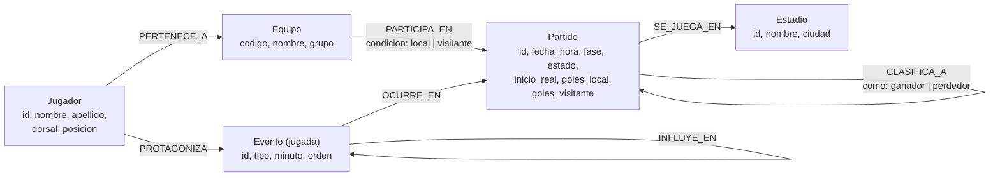

# Modelo de datos

## MongoDB — base `prode2030`

Colecciones, validación e índices se crean en [`seed/cargar_mongo.py`](../seed/cargar_mongo.py).

| Colección | `_id` | Campos | Índices además de `_id` |
|---|---|---|---|
| `usuarios` | `U0000001` | `nombre`, `pais`, `creado_en` | `pais` |
| `prodes` | `PR-` y 8 caracteres | `nombre`, `dueno`, `codigo` (invitación), `integrantes` (hasta 100), `creado_en` | `codigo` único; `integrantes` |
| `pronosticos` | `U0000001:P-07` | `usuario_id`, `partido_id`, `goles_local`, `goles_visitante`, `cargado_en`, `creado_en`; al puntuar: `puntos`, `exacto`, `tiempo_seg`, `anulado` | `usuario_id`; `partido_id` |
| `resultados` | `P-07` | `goles_local`, `goles_visitante`, `clasificado`, `inicio_programado`, `inicio_real`, `cerrado_en`, `puntuacion` | — |
| `puntajes` | `U0000001` | `puntos`, `exactos`, `tiempo_seg`, `aplicados` (partidos ya sumados) | `puntos`, `exactos`, `tiempo_seg` descendentes y `_id` |
| `rankings_historicos` | `P-07` | `generado_en`, `total_usuarios`, `primeros` (100) | — |
| `equipos` | `ARG` | `nombre`, `grupo` | — |
| `jugadores` | `J-ARG-09` | `nombre`, `apellido`, `dorsal`, `posicion`, `equipo` | `equipo`, `posicion` |
| `contadores` | `usuarios` | `valor` (último número de usuario entregado) | — |

`usuarios`, `prodes` y `pronosticos` tienen validación de esquema (`$jsonSchema`).

Un pronóstico ya puntuado (los valores son de ejemplo, para mostrar la forma):

```json
{
  "_id": "U0100001:P-07",
  "usuario_id": "U0100001",
  "partido_id": "P-07",
  "goles_local": 2,
  "goles_visitante": 1,
  "creado_en": "2026-11-17T19:15:41Z",
  "cargado_en": "2026-11-17T19:15:41Z",
  "puntos": 1,
  "exacto": false,
  "tiempo_seg": 172799,
  "anulado": false
}
```

`cargado_en` es la hora de la última corrección; es la que cuenta para el desempate.

El resultado de un partido, con el avance de su puntuación (también de ejemplo):

```json
{
  "_id": "P-07",
  "goles_local": 2,
  "goles_visitante": 0,
  "clasificado": null,
  "inicio_programado": "2026-11-21T18:00:00Z",
  "inicio_real": "2026-11-17T19:18:02Z",
  "cerrado_en": "2026-11-17T19:18:20Z",
  "puntuacion": {
    "estado": "completa",
    "pasos": {"puntuar": 33.8, "sumar": 77.9, "foto": 23.9},
    "pronosticos": 1,
    "iniciada_en": "2026-11-17T19:18:20Z",
    "terminada_en": "2026-11-17T19:18:21Z"
  }
}
```

Los estados de la puntuación son `pendiente`, `en_curso`, `completa` y `fallida`. Los tiempos de `pasos` están en milisegundos.

### Reglas de puntos y desempate

- 3 puntos por el resultado exacto, 1 por acertar el ganador o el empate, 0 si no.
- Orden del ranking: puntos, cantidad de exactos, tiempo acumulado y, a igualdad total, identificador de usuario. El sorteo final queda para el ranking de Redis.
- El tiempo de un pronóstico es cuántos segundos antes del horario programado quedó cargado, con tope de 5 días (432.000 segundos): entero si fue exacto, la mitad si solo acertó el ganador, cero si no acertó.
- Un pronóstico cargado cuando el partido ya había empezado se anula.

## Neo4j

Restricciones, índices y carga en [`seed/cargar_neo4j.py`](../seed/cargar_neo4j.py).



- Restricción de unicidad sobre `Equipo.codigo`, `Jugador.id`, `Estadio.id`, `Partido.id` y `Evento.id`. Índice sobre `Partido.fecha_hora`.
- `estado` vale `Programado`, `En juego` o `Finalizado`.
- Tipos de jugada: `Inicio`, `Pase`, `Tiro`, `Gol`, `Falta`, `Tarjeta amarilla`, `Tarjeta roja`, `Cambio`, `Final`.
- `INFLUYE_EN` va de la jugada anterior a la que provocó: `(pase)-[:INFLUYE_EN]->(tiro)-[:INFLUYE_EN]->(gol)`.
- `CLASIFICA_A` arma el cuadro: de cada partido de eliminatorias sale una relación al partido siguiente. Las dos semifinales tienen además una relación `perdedor` hacia el partido por el tercer puesto.

La consulta que recorre lo que llevó a una jugada:

```cypher
MATCH (fin:Evento {id: $evento})-[:OCURRE_EN]->(:Partido {id: $partido})
OPTIONAL MATCH (previo:Evento)-[:INFLUYE_EN*1..10]->(fin)
...
```

Todas las consultas están como constantes en [`app/adapters/neo4j.py`](../app/adapters/neo4j.py).

## Datos de laboratorio

Los genera [`seed/datos.py`](../seed/datos.py) con semilla fija: 48 equipos en 12 grupos, 26 jugadores por equipo, 16 estadios y 104 partidos (72 de grupos con sus equipos y 32 de eliminatorias sin equipos, enlazados en el cuadro). Los dos primeros partidos nacen jugados, con sus jugadas y su marcador, para tener cadenas que recorrer desde el arranque.


## Histórico de simulaciones

MongoDB conserva `guiones_simulacion`, un documento por partido con el equipo, el jugador, el minuto y los identificadores y relaciones de las jugadas previstas; la simulación copia ese guion en su ficha. InfluxDB conserva las muestras por equipo y minuto. Al cerrar, el servicio cruza las jugadas del guion con los goles y contadores de las muestras, valida el marcador y guarda en Neo4j:

- `(:Partido)-[:ESTADISTICA_MINUTO]->(:Equipo)`, una relación por equipo y minuto.
- `(:Partido)-[:RESUMEN_ESTADISTICO]->(:Equipo)`, una relación con los agregados de cada equipo.
- `(:Evento)-[:OCURRE_EN]->(:Partido)`, `(:Jugador)-[:PROTAGONIZA]->(:Evento)` y `(:Evento)-[:INFLUYE_EN]->(:Evento)` para las jugadas del guion.

Las jugadas son hechos sintéticos definidos por el guion; no se inventa un jugador para cada pase o tiro agregado. Las acciones estadísticas adicionales permanecen como contadores. El archivado se puede repetir y rechaza muestras incompletas, goles contradictorios, jugadores inexistentes y conflictos de IDs.

## Redis

Claves que usa la API. Todas viven en el primario; la réplica (`redis_replica`) recibe una copia de lectura.

| Clave | Tipo | Qué guarda | Vence |
|---|---|---|---|
| `sesion:{token}` | texto | Id del usuario de esa sesión | 24 h desde el último uso |
| `audiencia:{partido}:{pais}` | conjunto ordenado | Quién está mirando: un resumen del token de cada conexión abierta, con la hora de su última señal como puntaje | Cada miembro deja de contar si no da señal en 15 s; sale al cerrar la conexión |
| `unicos:{partido}:{pais}` | HyperLogLog | Usuarios distintos que miraron el partido desde ese país | No |
| `paises:{partido}` | conjunto | Países con espectadores o comentarios en el partido | No |
| `cuenta:{partido}:{pais}:{origen}` | contador | Comentarios del minuto en curso; el simulador lo toma y lo borra al cerrar cada minuto | Al leerse |
| `visto:{comentario_id}` | texto | El comentario ya guardado, para responder igual a un reintento | 10 min |
| `lento:{usuario}` | texto | Marca del modo lento | 5 s |

Canales de publicación y suscripción: `chat:{partido}:{pais}` y `chat:{partido}:todos` (cada comentario se publica en los dos) y `estado:{partido}` (minuto, marcador y audiencia, una vez por minuto simulado). Cada proceso de la API tiene una sola suscripción compartida por todas sus conexiones en vivo.

## Cassandra — keyspace `fixture2030`

Replicación `NetworkTopologyStrategy {'america': 1, 'europa': 1}`: una copia completa en cada región. El esquema está en [`cassandra/esquema.cql`](../cassandra/esquema.cql) y lo aplica, de forma repetible, [`cassandra/iniciar.sh`](../cassandra/iniciar.sh).

```sql
CREATE TABLE fixture2030.comentarios_por_partido_pais (
  partido_id text, pais text, ventana timestamp, creado_en timestamp, comentario_id uuid,
  usuario_nombre text, contenido text, origen text,
  PRIMARY KEY ((partido_id, pais, ventana), creado_en, comentario_id)
) WITH CLUSTERING ORDER BY (creado_en DESC, comentario_id ASC);
```

- La partición es partido, país y ventana de media hora: la tribuna de un país en un tramo del partido. Acota el tamaño de cada partición y reparte la escritura de un partido con mucha gente.
- `origen` separa los comentarios de usuarios de los automáticos del simulador.
- Sin vencimiento: se guardan para el análisis posterior.
- El historial recorre ventanas hacia atrás; "todos los países" lee la partición de cada país con actividad y las mezcla por fecha.

## InfluxDB — tres bases

| Base | Vence | Qué guarda |
|---|---|---|
| `fixture2030_raw` | A los 7 días | Las muestras crudas de cada simulación nueva (`estadisticas_jugador_minuto`, `jugadas_partido`). Al terminar el partido se archivan en Neo4j |
| `fixture2030_resumenes` | No | Totales de cada partido (`resumen_partido_equipo`, `resumen_partido_jugador`) y la audiencia y los comentarios por minuto (abajo) |
| `fixture2030_metrics` | No | Las simulaciones anteriores a la separación; se siguen leyendo desde ahí |

La audiencia, en `fixture2030_resumenes`:

| Medida | Etiquetas | Campos | Cuándo se escribe |
|---|---|---|---|
| `audiencia_partido` | `partido_id`, `pais`, `corrida_id`, `tipo` | `espectadores`, `minuto` | Una fila por país en cada minuto simulado |
| `comentarios_partido` | `partido_id`, `pais`, `origen`, `corrida_id`, `tipo` | `comentarios`, `minuto` | Una fila por país y origen en cada minuto simulado |
| `audiencia_resumen` | `partido_id`, `pais`, `corrida_id`, `tipo` | `unicos` | Una fila por país al terminar el partido |

`tipo` es `demo` o `carga`. `corrida_id` identifica cada simulación: las consultas de un partido usan la última. Las etiquetas son las que se usan para filtrar o agrupar; el minuto es un campo, como en las demás medidas de la simulación. Cada partido escribe, por país, 91 filas de audiencia y 182 de comentarios.
