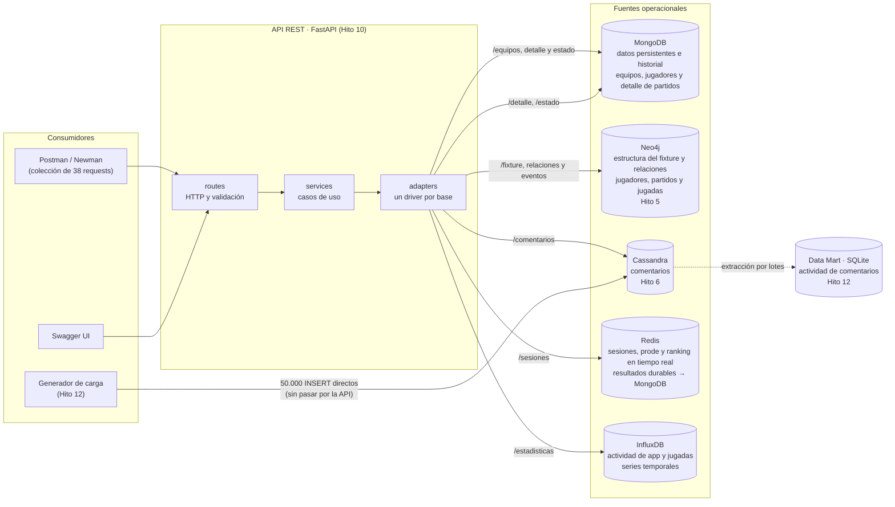
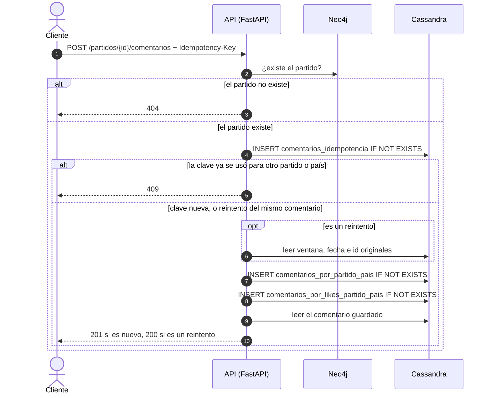
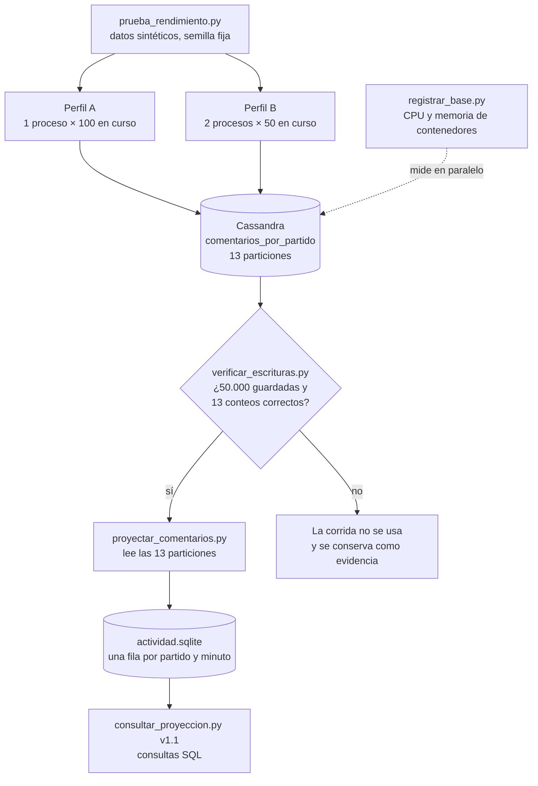

# Arquitectura del Fixture 2030

Vista general de la plataforma que se fue armando a lo largo de los hitos. Los diagramas están escritos en Mermaid: GitHub los dibuja a partir del texto de los bloques `mermaid`.

## 1. Componentes y fuentes de datos

Cada base resuelve un tipo de acceso distinto. La API (Hito 10) tiene un adaptador por base y cada endpoint consulta solo la fuente que le corresponde.

## 2. Crear un comentario (escritura con dos bases)

`POST /partidos/{id}/comentarios` es el único endpoint que combina fuentes: verifica el partido en Neo4j y guarda en Cassandra. La `Idempotency-Key` permite reintentar sin duplicar.

## 3. Prueba de carga y Data Mart (Hito 12)

Camino que sigue la prueba: se carga, se verifica que no falte ni sobre nada, y recién después se proyecta la vista analítica.

